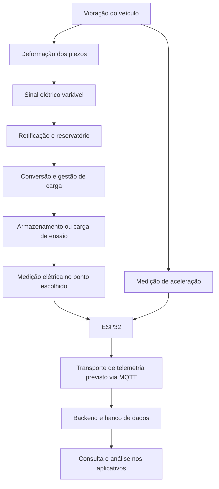

<!-- Explica os fundamentos físicos e a interpretação experimental do VERS. -->
# VERS — conceito e funcionamento

Data: 20/10/2026. Leitura complementar: [esquema elétrico](05_esquema-eletrico.md),
[visão geral](01_visao-geral-vers.md) e [indicadores](03_dados-e-indicadores.md).

## 1. Qual é a ideia do projeto?

O VERS (Vibration Energy Recovery System) é um projeto acadêmico que investiga
quanto de energia elétrica pode ser recuperado de vibrações veiculares por meio
de elementos piezoelétricos e em quais condições essa recuperação é útil.

Motor, suspensão e irregularidades do pavimento produzem movimento. Uma estrutura
mecânica transfere parte desse movimento para os piezos, que se deformam e geram
carga elétrica. O circuito condiciona essa energia, enquanto sensores permitem
comparar geração, vibração e condições do teste.

É uma tecnologia complementar. O projeto não demonstrou substituição do alternador,
autonomia energética, economia de combustível ou potência suficiente para cargas
veiculares. Tais resultados dependem de medição e de um balanço completo.

## 2. Da vibração à eletricidade

### Deformação é o que aciona o piezo

O efeito piezoelétrico direto relaciona esforço mecânico e geração de carga.
Um modelo simplificado, sob condições definidas, é `Q ≈ d × F`, em que Q é carga,
F é força aplicada e d representa o coeficiente efetivo do modo de operação.
Geometria, material, direção da força e montagem limitam o uso dessa aproximação.

O elemento também apresenta capacitância: aproximadamente `V = Q / C_p`.
Assim, uma pequena carga em uma capacitância pequena pode gerar tensão elevada.
Isso explica por que medir muitos volts em vazio não comprova capacidade de
alimentar uma carga. A tensão pode cair fortemente quando se extrai corrente.

Uma representação elétrica útil é uma fonte de corrente em paralelo com sua
capacitância e perdas. A carga conectada altera a resposta; o piezo não se
comporta como uma fonte ideal de tensão constante.

### Fixação e frequência influenciam o resultado

O suporte precisa produzir deformação útil sem quebrar o material. Apenas colar
um disco numa região que se move não garante boa transferência de energia.
Rigidez, massa, orientação, amortecimento e frequência de excitação influenciam
a resposta. Uma montagem pode ter maior resposta perto de uma ressonância, mas
vibrações veiculares variam e não mantêm necessariamente essa frequência.

Mais piezos não garantem crescimento proporcional de energia. É preciso
considerar deformação de cada elemento, fase dos sinais, associação e perdas.

## 3. O que cada etapa faz?

O diagrama mostra a sequência conceitual; o sensor elétrico é instalado no
caminho de corrente, conforme o esquema elétrico, e não recebe energia depois
do armazenamento como uma nova etapa de conversão.

| Etapa | Função | Limitação importante |
| --- | --- | --- |
| Piezo | Converter deformação em carga elétrica | Geração depende da montagem e excitação |
| Ponte | Tornar unidirecional o fluxo para o reservatório | Quedas e fugas reduzem a energia aproveitada |
| Capacitor | Acumular carga e reduzir variações | Não cria energia e tem perdas |
| DC-DC | Adaptar a tensão ao próximo estágio | Tem perdas, consumo próprio e requisito de partida |
| Gestão de carga | Adequar a carga ao armazenamento | Deve corresponder à tecnologia escolhida |
| Armazenamento | Reter energia para uso posterior | Energia recebida difere da energia depois extraível |
| INA219 | Medir tensão e corrente em um ponto CC | Faixa e resolução precisam servir ao experimento |
| MPU6050 | Medir aceleração e movimento | Não mede diretamente força nem energia mecânica |
| ESP32 | Adquirir e transmitir dados | Também consome energia |

A cadeia é conceitual: um componente integrado pode reunir várias funções.
Não há exigência de uma placa separada para cada bloco.

## 4. De onde vem a energia?

A energia elétrica recuperada vem da energia mecânica transmitida à montagem.
A extração introduz acoplamento e amortecimento; não é geração gratuita.
Mesmo aproveitando vibração que seria dissipada, não se pode concluir economia
líquida de combustível sem medir os efeitos e o consumo do conjunto.

Para um mesmo intervalo e fronteira de medição:

`E_mecânica recebida = E_elétrica extraída + perdas + variação da energia interna`

As perdas incluem dissipação mecânica e elétrica, retificação, conversão e fuga.
A expressão exige considerar a energia que permanece temporariamente nos
componentes ao início e ao fim do intervalo.

Para um conjunto alimentado pelo próprio armazenamento:

`ΔE_armazenada = E_entregue − E_cargas − E_perdas de armazenamento`

Se a instrumentação usar fonte externa, informar essa condição. O ensaio pode
caracterizar geração, mas não demonstrar funcionamento autossustentado.

## 5. O que medir e como interpretar?

### Tensão, corrente e potência

`P(t) = V(t) × I(t)`.

Usar tensão e corrente do mesmo ponto elétrico e de instantes compatíveis.
Multiplicar tensão média por corrente média pode produzir resultado diferente
da média dos produtos quando os sinais variam.

Exemplo didático, sem representar resultado do VERS: 3 V e 2 mA correspondem
a `3 × 0,002 = 0,006 W`, ou 6 mW.

### Energia e duração

`E_J = ∫ P(t) dt` e `E_Wh = E_J / 3600`.

Para amostras, uma aproximação trapezoidal é:

`E_Wh ≈ Σ [(P_i + P_(i+1)) / 2] × Δt_segundos / 3600`.

No exemplo constante de 6 mW durante 10 minutos:

`E = 0,006 × 600 = 3,6 J = 0,001 Wh`.

Esse exemplo mostra a diferença entre um pico de potência e energia acumulada.
Para intervalos irregulares, a potência média deve ser ponderada pelo tempo;
não preencher períodos sem dados como se a potência fosse conhecida.

Para um capacitor de capacitância conhecida, outra verificação é
`ΔE = ½ C (V_final² − V_inicial²)`. Ela estima a mudança de energia do capacitor,
não a energia total gerada se existirem cargas ou perdas durante o ensaio.
Em baterias, tensão isolada não mede diretamente energia armazenada.

### Eficiência e consumo próprio

`η = E_útil / E_mecânica de entrada × 100%` só é justificável com ambas as
energias medidas ou estimadas por método validado e na mesma fronteira.
Aceleração RMS sozinha não fornece esse denominador. Uma avaliação mecânica pode
exigir força e velocidade compatíveis, integrando `P_mecânica = F · v`.

Sem esse método, reportar energia recuperada, potência média, perdas mensuráveis
e consumo da instrumentação. Para autonomia, comparar geração com consumo total
no mesmo intervalo, incluindo transmissão, espera, partida e perdas.

### Vibração e variáveis externas

Registrar eixos, unidade, orientação, frequência de aquisição, janela e remoção
da gravidade antes de interpretar RMS como vibração dinâmica. Amostragem e
filtragem devem capturar a banda de interesse sem confundir aliasing com sinal.

Velocidade, RPM, massa, pavimento e inclinação ajudam a contextualizar os testes.
Não são substitutos da medição elétrica nem provam causalidade individualmente.
Maior aceleração nem sempre significa maior energia recuperada: frequência,
acoplamento e carga também mudam o resultado.

## 6. Como o conceito se conecta ao software?

O ESP32 deverá associar leituras à instalação/configuração e transmitir dados.
O caminho previsto usa MQTT; o backend valida e persiste a telemetria para consulta.
Isso descreve a arquitetura de destino, não comprova firmware ou circuito pronto.
O [contrato MQTT v1](Api/mqtt-contract-v1.md) descreve um perfil de ensaio sintético:
sua cadência e seus valores não certificam aquisição física.

| Informação | Campo/unidade no contrato |
| --- | --- |
| Tensão e corrente | `voltageV` (V), `currentA` (A) |
| Potência informada pelo dispositivo | `devicePowerW` (W), separada do cálculo do backend |
| Contador de energia | `accumulatedEnergyWh` (Wh) |
| Aceleração por eixo | `accelerationXMs2`, `accelerationYMs2`, `accelerationZMs2` (m/s²) |
| Vibração RMS | `vibrationRmsMs2` (m/s²), com método documentado |
| Quantidade ativa | `activePiezoCount`, sem diagnóstico individual implícito |
| Momento da amostra | `capturedAt`, UTC |

A amostragem local pode precisar ser mais rápida que o envio de lotes.
Falhas e ausências não devem virar zero. No contrato atual de recuperação,
a corrente aceita é não negativa; ensaios com descarga ou corrente reversa
exigem tratar essa situação explicitamente, sem converter sinais silenciosamente.
O esquema elétrico deve definir se o sensor verá tais fluxos.

## 7. Como demonstrar o conceito experimentalmente?

1. Registrar configuração, associação, fixação, armazenamento, ponto medido,
   calibração e fonte da instrumentação.
2. Fazer uma referência sem excitação para identificar offset, fuga e energia
   previamente presente no reservatório.
3. Aplicar excitação repetível com carga definida e registrar simultaneamente
   movimento e grandezas elétricas, dentro da capacidade dos instrumentos.
4. Repetir o teste mantendo as condições e alterar uma variável por vez, como
   associação dos piezos ou carga elétrica.
5. Comparar energia por duração, potência média, disponibilidade de dados e
   repetibilidade; informar incerteza e intervalos sem medição.
6. Se houver ensaio veicular, registrar as condições do percurso e validar antes
   a montagem, a fixação e as proteções adequadas ao ambiente.

Uma evidência convincente relaciona excitação controlada a energia entregue a
uma carga ou armazenada, descontando fontes externas e energia inicial.
Um LED piscando ou um pico de tensão isolado demonstra apenas uma parte do processo.

## 8. O que o projeto ainda precisa comprovar?

- Energia útil por condição de operação, com ponto e método de medição definidos.
- Associação e montagem mecânica que entregam melhor resultado experimental.
- Compatibilidade de partida, perdas e consumo com a geração disponível.
- Durabilidade, segurança e repetibilidade em ambiente veicular.
- Viabilidade de uma carga-alvo, depois de medir seu consumo real.

A escolha dessas metas operacionais cabe ao responsável pelo projeto. Este
documento explica como avaliá-las sem fixar potência, economia ou autonomia ainda
não demonstradas.
